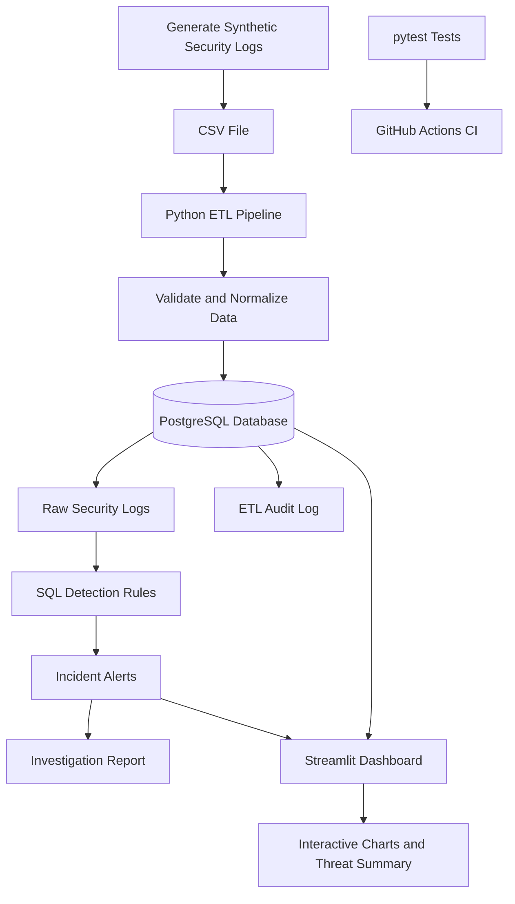
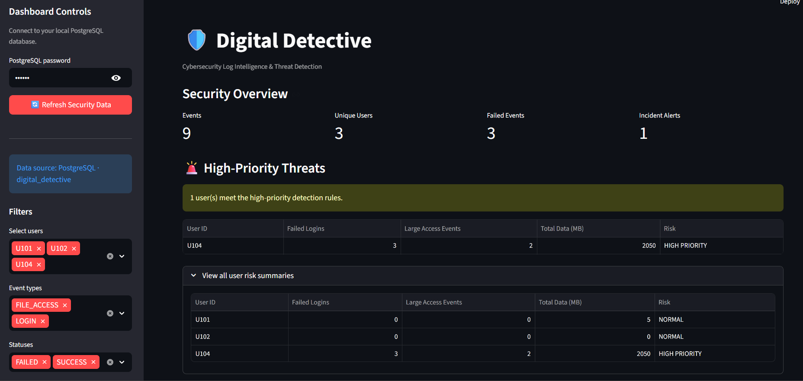
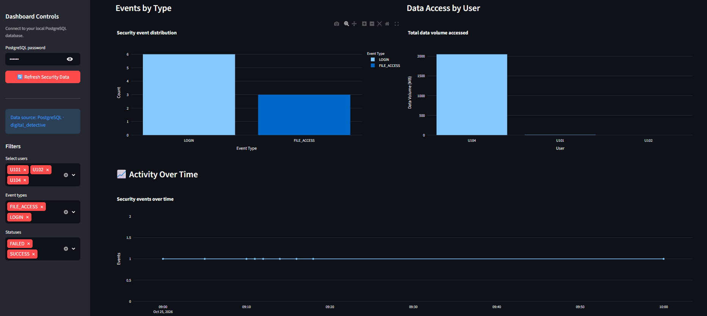
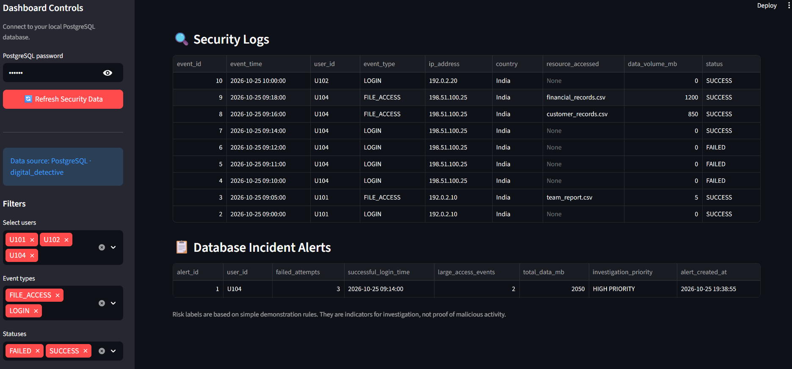

# 🛡️ Digital Detective: Cybersecurity Log Intelligence & Threat Detection

## Project Overview

Digital Detective is a Python and PostgreSQL data analytics project that analyzes synthetic cybersecurity logs to identify suspicious login patterns, repeated failed login attempts, and unusually large file-access activity.

The project combines a Python ETL pipeline, SQL-based threat detection, automated incident alerts, data-quality validation, and an interactive Streamlit dashboard to support security investigations.

It demonstrates practical skills in Python, SQL, PostgreSQL, data engineering, data analytics, data visualization, automated testing, and continuous integration.

## Objectives

- Build a repeatable Python ETL pipeline.
- Store and analyze security logs using PostgreSQL.
- Validate and normalize incoming data.
- Skip duplicate records during data ingestion.
- Detect suspicious activity using SQL rules.
- Generate incident alerts and prevent duplicate alerts.
- Track pipeline executions using an ETL audit log.
- Produce user-level investigation reports.
- Visualize security events through an interactive dashboard.
- Automate Python tests using GitHub Actions.

## Technology Stack

| Category | Technologies |
|---|---|
| Programming | Python |
| Database | PostgreSQL |
| Data processing | Python CSV module, Pandas |
| Database connectivity | psycopg2 |
| Querying and detection | SQL |
| Dashboard | Streamlit |
| Visualization | Plotly |
| Testing | pytest |
| Continuous integration | GitHub Actions |
| Version control | Git, GitHub |

## System Architecture



## How It Works

1. **Generate logs:** Python creates synthetic login and file-access events.
2. **Validate input:** The ETL pipeline checks required CSV columns and validates individual records.
3. **Normalize data:** The pipeline standardizes incoming values before database insertion.
4. **Load data:** Python connects to PostgreSQL, skips duplicate records, and inserts new security events.
5. **Track execution:** An ETL audit log records pipeline execution information.
6. **Detect suspicious activity:** SQL rules identify repeated failed logins and unusually large file-access events.
7. **Generate alerts:** The investigation process assigns priorities and creates incident records while preventing duplicate alerts.
8. **Analyze results:** SQL reports and Python analytics summarize user activity and data-access patterns.
9. **Visualize activity:** Streamlit and Plotly display security metrics, threat summaries, charts, logs, and incident alerts.
10. **Test changes:** pytest runs automated tests, while GitHub Actions executes the tests in a CI workflow.

## Database Tables

| Table | Purpose |
|---|---|
| `raw_security_logs` | Stores raw login and file-access events. |
| `incident_alerts` | Stores generated security investigation alerts. |
| `etl_audit_log` | Tracks ETL execution and processing information. |

## Detection Rules

The SQL investigation logic identifies high-priority activity when both conditions are met:

- At least three failed login attempts.
- At least two file-access events involving 500 MB or more per event.

These are illustrative detection rules designed for a learning project. A high-priority alert indicates that further investigation may be warranted; it does not prove malicious activity.

The dashboard also calculates its own demonstration risk indicators. These dashboard indicators are intended to support investigation and should not be confused with the authoritative incident alerts generated by the SQL pipeline.

## Sample Results

The synthetic dataset produced the following investigation summary:

| User ID | Failed Logins | Successful Logins | Large Access Events | Data Accessed | Priority |
|---|---:|---:|---:|---:|---|
| U104 | 3 | 1 | 2 | 2,050 MB | HIGH PRIORITY |
| U101 | 0 | 1 | 0 | 5 MB | REVIEW |
| U102 | 0 | 1 | 0 | 0 MB | REVIEW |

U104 experienced three failed login attempts followed by a successful login, then accessed two large files:

- `customer_records.csv` — 850 MB
- `financial_records.csv` — 1,200 MB

The total data volume associated with these two large-access events was 2,050 MB.

See [`reports/sample_investigation_results.md`](reports/sample_investigation_results.md) for the sample investigation report.

See [`reports/security_log_analytics.md`](reports/security_log_analytics.md) for the generated analytics summary.

## Interactive Security Dashboard

The Streamlit dashboard connects to PostgreSQL and provides an interactive interface for examining security activity.

### Dashboard Features

- **Security overview:** Total events, unique users, failed events, and incident alerts.
- **High-priority threat panel:** Highlights users who meet the dashboard's risk rules.
- **Event distribution chart:** Shows the number of events by event type.
- **Data-access chart:** Compares data-access volumes across users.
- **Activity timeline:** Displays security events over time.
- **Interactive filters:** Filter events by user, event type, and status.
- **Security logs table:** Inspect event timestamps, users, IP addresses, countries, accessed resources, data volumes, and statuses.
- **Incident alerts table:** Review database-generated incident records and investigation priorities.
- **Refresh control:** Reload the latest records from PostgreSQL.

## Dashboard Screenshots

### Security Overview


### Security Analytics


### Security Logs and Alerts


*The dashboard uses synthetic data and illustrative detection rules. Screenshots should not contain passwords or other sensitive information.*

## Project Structure

```text
digital-detective/
├── .github/
│   └── workflows/
│       └── tests.yml
├── data/
│   └── security_logs.csv
├── reports/
│   ├── dashboard.png
│   ├── dashboard_analytics.png
│   ├── dashboard_logs.png
│   ├── sample_investigation_results.md
│   └── security_log_analytics.md
├── sql/
│   ├── 01_create_tables.sql
│   ├── 02_detect_suspicious_activity.sql
│   ├── 03_create_incident_alerts.sql
│   ├── 04_generate_incident_alerts.sql
│   ├── 05_prevent_duplicate_alerts.sql
│   ├── 06_create_etl_audit_log.sql
│   └── 07_final_investigation_report.sql
├── src/
│   ├── generate_logs.py
│   ├── log_utils.py
│   ├── load_logs.py
│   ├── run_investigation.py
│   └── analyze_logs.py
├── tests/
│   ├── test_generate_logs.py
│   └── test_load_logs.py
├── dashboard.py
├── .gitignore
├── requirements.txt
└── README.md
```

*Note: `data/security_logs.csv` is generated locally and is ignored by Git in the current configuration. It may not appear in the GitHub repository.*

## Setup and Execution

### Prerequisites

- Python 3.10 or later
- PostgreSQL
- Git
- A GitHub account for repository hosting and GitHub Actions

### 1. Clone the Repository

```bash
git clone https://github.com/UjwalaPadala/digital-detective.git
cd digital-detective
```

### 2. Install Dependencies

Install the project dependencies:

```bash
python -m pip install -r requirements.txt
```

Install the dashboard dependencies if they are not already included:

```bash
python -m pip install streamlit plotly
```

### 3. Create the PostgreSQL Database

Create a PostgreSQL database named `digital_detective`.

Run the SQL scripts in the `sql/` folder in numerical order to create the tables, detection logic, incident-alert logic, duplicate prevention, and ETL audit log.

If you have already set up the project, do not recreate the existing database unnecessarily.

### 4. Generate Synthetic Logs

From the project root, run:

```bash
python src/generate_logs.py
```

This generates the local security-log CSV file.

### 5. Load Logs into PostgreSQL

Run:

```bash
python src/load_logs.py
```

Follow the database authentication prompts if applicable.

The ETL pipeline validates the input, normalizes records, skips duplicates, and loads the data into PostgreSQL.

### 6. Generate Incident Alerts

Run:

```bash
python src/run_investigation.py
```

The script executes the investigation process and reports generated incident alerts.

### 7. Generate the Analytics Report

Run:

```bash
python src/analyze_logs.py
```

This generates the analytics summary in `reports/security_log_analytics.md`.

### 8. Run the Final Investigation Report

Execute `sql/07_final_investigation_report.sql` against the `digital_detective` database using PostgreSQL's `psql` command-line tool.

### 9. Launch the Dashboard

Start Streamlit from the project root:

```bash
python -m streamlit run dashboard.py
```

Open the local URL displayed in your terminal, usually `http://localhost:8501`.

Enter your PostgreSQL password in the sidebar and select **Refresh Security Data** to load the records.

### 10. Run Automated Tests

Run the tests locally:

```bash
python -m pytest -v
```

The current test suite contains seven tests covering log generation and ETL input validation and normalization.

### 11. Continuous Integration

GitHub Actions runs the automated tests when code is pushed or a pull request is opened.

To inspect the results, open the repository's **Actions** tab and select the **Python Tests** workflow.

## Limitations

- The project uses a small synthetic dataset rather than real production security logs.
- Detection rules are illustrative and may generate false positives.
- Dashboard risk calculations use demonstration thresholds.
- The current tests focus on log generation and ETL validation rather than full end-to-end database integration.
- The project is a portfolio and learning demonstration, not a production security monitoring system.

## Future Improvements

- Introduce configurable detection thresholds and severity levels.
- Evaluate detection performance using larger, labelled datasets.
- Expand automated tests for SQL detection logic and database integration.
- Add scheduled ETL execution and monitoring.
- Improve historical trend analysis and incident investigation workflows.
- Explore additional methods for detecting unusual login and data-access behavior.

## Author

**Ujwala Padala**

GitHub: [UjwalaPadala](https://github.com/UjwalaPadala)

Repository: [Digital Detective](https://github.com/UjwalaPadala/digital-detective)
