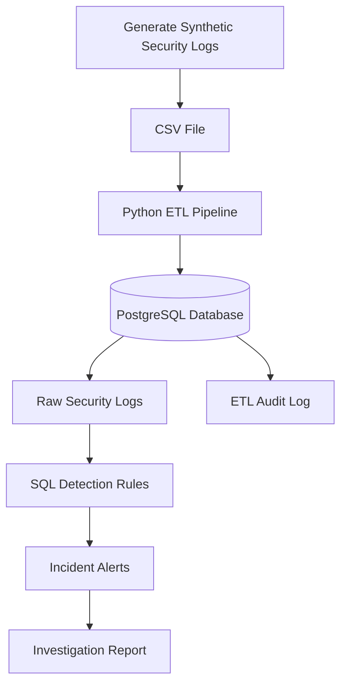

# Digital Detective: Cybersecurity Log Intelligence & Threat Detection

## Project Overview

Digital Detective is a Python and PostgreSQL data analytics project that analyzes synthetic cybersecurity logs to identify suspicious login patterns and unusually large file-access activity.

The system uses an ETL pipeline to load security events, SQL rules to flag activity requiring investigation, and automated incident alerts to prioritize potentially suspicious behavior.

## Objectives

- Build a repeatable Python ETL pipeline.
- Store and analyze security logs using PostgreSQL.
- Detect suspicious patterns with SQL.
- Generate incident alerts and prevent duplicate alerts.
- Track pipeline executions using an ETL audit log.
- Produce user-level investigation reports.

## Technology Stack

- **Programming:** Python
- **Database:** PostgreSQL
- **Data processing:** Python CSV module
- **Database connectivity:** psycopg2
- **Analysis:** SQL, Pandas
- **Version control:** Git and GitHub

## System Architecture



## How It Works

1. **Generate logs:** Python creates synthetic login and file-access events.
2. **Load data:** The ETL pipeline reads the CSV file, skips duplicate records, and inserts new records into PostgreSQL.
3. **Store events:** PostgreSQL maintains the raw security logs, incident alerts, and ETL execution history.
4. **Detect suspicious activity:** SQL rules identify repeated failed logins and large file-access events.
5. **Generate alerts:** The system assigns investigation priorities and produces a user-level report.

## Database Tables

| Table | Purpose |
|---|---|
| `raw_security_logs` | Stores login and file-access events |
| `incident_alerts` | Stores generated investigation alerts |
| `etl_audit_log` | Tracks ETL status and inserted or skipped records |

## Detection Rules

The investigation report flags a user as **HIGH PRIORITY** when both conditions are met:

- At least three failed login attempts.
- At least two file-access events involving 500 MB or more per event.

These are illustrative rules for this project. A high-priority alert indicates a need for further investigation; it does not prove malicious activity.

## Sample Results

The synthetic dataset produced the following investigation summary:

| User ID | Failed Logins | Successful Logins | Large Access Events | Data Accessed | Priority |
|---|---:|---:|---:|---:|---|
| U104 | 3 | 1 | 2 | 2,050 MB | HIGH PRIORITY |
| U101 | 0 | 1 | 0 | 5 MB | REVIEW |
| U102 | 0 | 1 | 0 | 0 MB | REVIEW |

U104 had three failed login attempts followed by a successful login, then accessed two large files: `customer_records.csv` and `financial_records.csv`.

See [`reports/sample_investigation_results.md`](reports/sample_investigation_results.md) for the sample investigation report.

## Project Structure

```text
digital-detective/
├── data/
│   └── security_logs.csv       # Generated locally
├── reports/
│   └── sample_investigation_results.md
├── sql/
│   ├── 01_create_tables.sql
│   ├── 02_detect_suspicious_activity.sql
│   ├── 03_create_incident_alerts.sql
│   ├── 04_generate_incident_alerts.sql
│   ├── 05_prevent_duplicate_alerts.sql
│   ├── 06_create_etl_audit_log.sql
│   └── 07_final_investigation_report.sql
├── src/
│   ├── generate_logs.py
│   ├── load_logs.py
│   └── run_investigation.py
├── .gitignore
├── requirements.txt
└── README.md
```

## Setup and Execution

### Prerequisites

- Python 3.10 or later
- PostgreSQL
- Git

### 1. Clone the repository

```bash
git clone YOUR_REPOSITORY_URL
cd digital-detective
```

Replace `YOUR_REPOSITORY_URL` with your actual GitHub repository URL.

### 2. Install dependencies

```bash
python -m pip install -r requirements.txt
```

### 3. Create the PostgreSQL database

Create a database named `digital_detective` in PostgreSQL.

Run the SQL scripts in the `sql/` folder in numerical order to create the tables, detection logic, incident-alert table, duplicate prevention, and audit log.

### 4. Generate synthetic logs

```bash
python src/generate_logs.py
```

### 5. Load logs into PostgreSQL

```bash
python src/load_logs.py
```

Enter your PostgreSQL password when prompted.

### 6. Generate incident alerts

```bash
python src/run_investigation.py
```

### 7. Run the final investigation report

Execute `sql/07_final_investigation_report.sql` against the `digital_detective` database using PostgreSQL's `psql` command-line tool.

## Limitations

- The project uses a small synthetic dataset.
- Detection rules are illustrative and may generate false positives.
- The project is a learning and portfolio demonstration, not a production security monitoring system.

## Future Improvements

- Add automated tests and continuous integration.
- Develop a dashboard for incident trends.
- Introduce configurable detection thresholds.
- Test detection performance using larger, labelled datasets.
- Add scheduled pipeline execution and monitoring.
